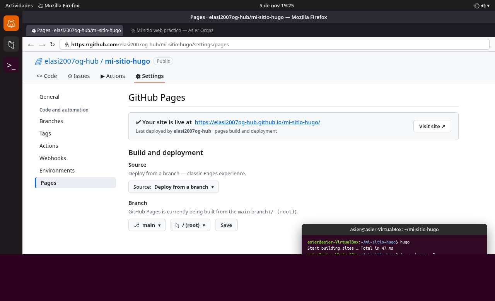
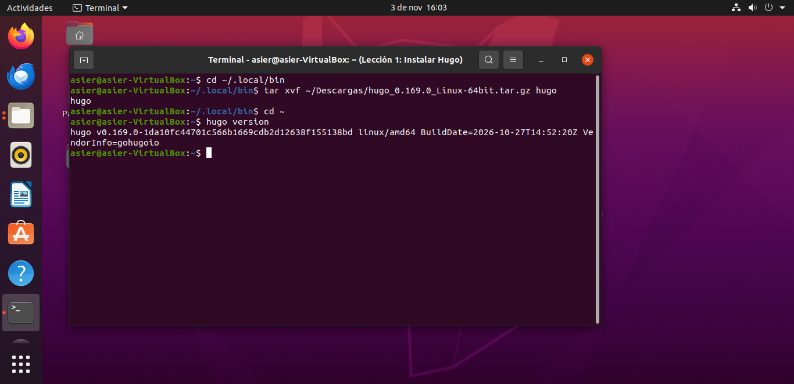
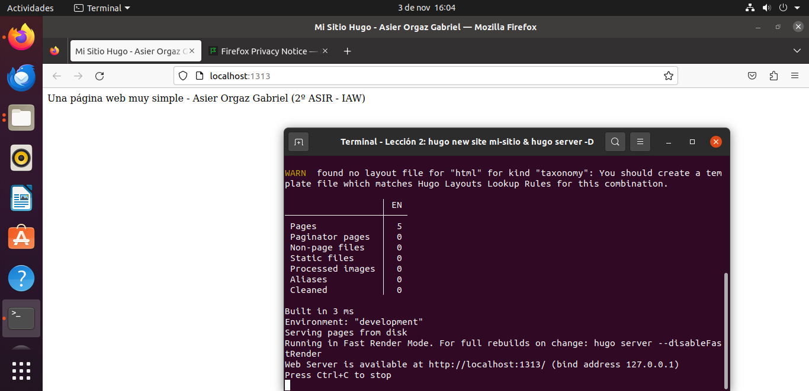
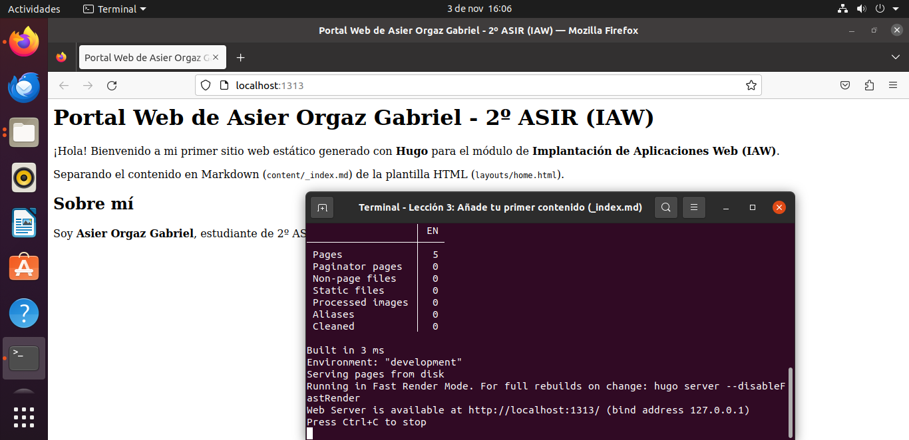
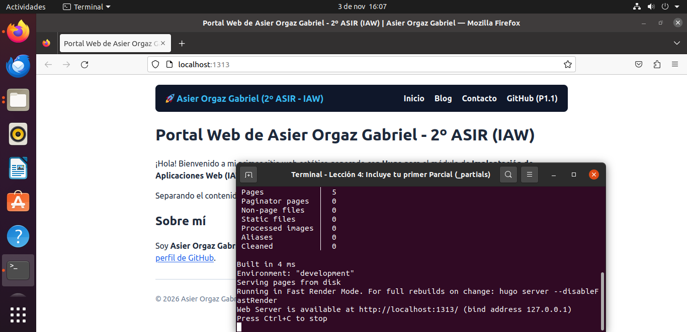
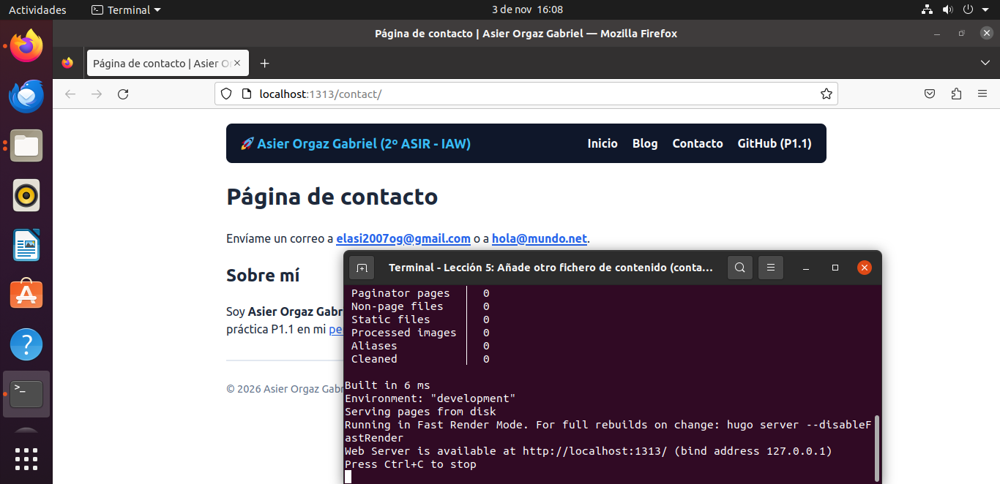
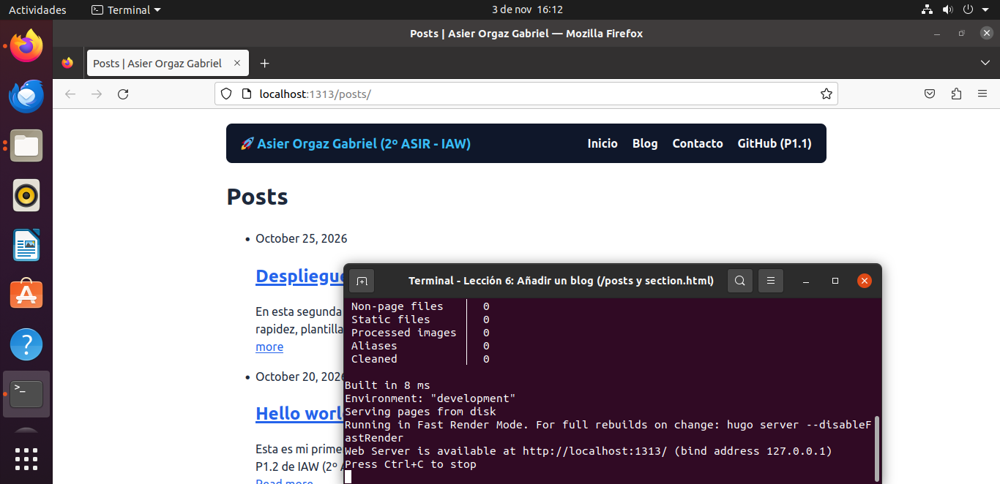
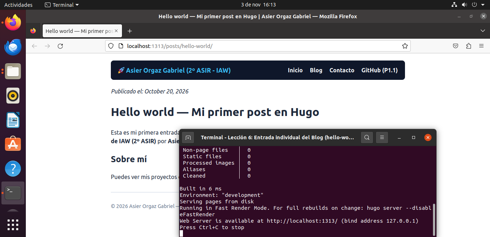
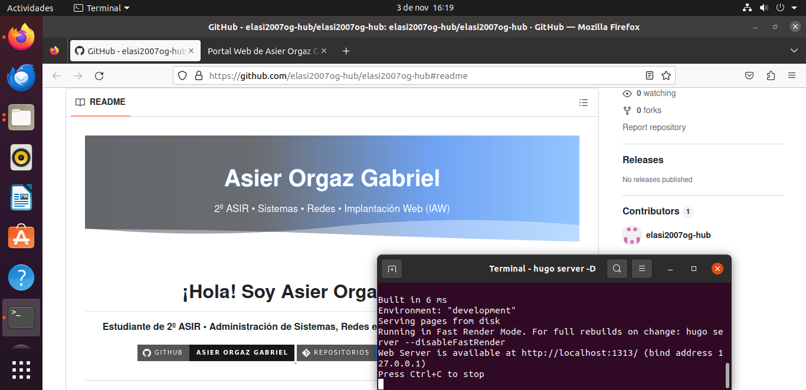

# PrácticaX2 y P1.2 (IAW) — Publicar tu sitio Hugo con GitHub Pages

- **Alumno:** Asier Orgaz Gabriel
- **Módulo:** Implantación de Aplicaciones Web (IAW) — 2º ASIR
- **URL pública en GitHub Pages:** [https://elasi2007og-hub.github.io/mi-sitio-hugo/](https://elasi2007og-hub.github.io/mi-sitio-hugo/)
- **Repositorio GitHub (fuente Hugo + HTML en raíz):** [https://github.com/elasi2007og-hub/mi-sitio-hugo](https://github.com/elasi2007og-hub/mi-sitio-hugo)
- **Perfil de GitHub (P1.1 enlazado):** [https://github.com/elasi2007og-hub/elasi2007og-hub](https://github.com/elasi2007og-hub/elasi2007og-hub)

---

## Despliegue en GitHub Pages (PrácticaX2)

### Configuración aplicada en `hugo.toml`
```toml
baseURL = "https://elasi2007og-hub.github.io/mi-sitio-hugo/"
languageCode = "es"
title = "Mi sitio web práctico — Asier Orgaz Gabriel"
description = "Ejercicio de publicación con Hugo y GitHub Pages para Implantación de Aplicaciones Web (2º ASIR)"
publishDir = "."
disableKinds = ["taxonomy", "term"]

[params]
  description = "Ejercicio de publicación con Hugo y GitHub Pages para Implantación de Aplicaciones Web (2º ASIR)"
  author = "Asier Orgaz Gabriel"
  github = "https://github.com/elasi2007og-hub/elasi2007og-hub"
```

### Flujo de publicación ejecutado
1. Creación de `static/.nojekyll` para servir el HTML plano directamente sin procesamiento Jekyll.
2. Uso de `relURL` y `.Site.Home.RelPermalink` en `layouts/partials/header.html` para cargar `css/estilo.css` y las rutas de navegación bajo `/mi-sitio-hugo/`.
3. Personalización de `<title>{{ .Site.Title }}</title>` y `<meta name="description" content="{{ .Site.Params.description }}">`.
4. Compilación en la raíz del repositorio mediante `hugo` (`publishDir = "."`) con todas las páginas en `draft: false`.
5. Activación de **GitHub Pages** en `Settings → Pages` con `Deploy from a branch: main` y carpeta `/ (root)`.



---

## 1. Historial de Comandos Empleados (`history`)

A continuación se detalla la secuencia exacta de comandos ejecutados en la máquina virtual Ubuntu (`asier@asier-VirtualBox`) siguiendo la guía de **Librebits** (*Instalar Hugo en una máquina virtual*) y las **6 lecciones oficiales de Hugo Codex (`hugocodex.org/es/empezando/`)**:

```bash
# ==============================================================================
# PASO 1 y LECCIÓN 1: Instalación de Hugo en la Máquina Virtual (vía GitHub Releases)
# ==============================================================================
mkdir -p ~/.local/bin ~/Descargas
cd ~/Descargas
wget https://github.com/gohugoio/hugo/releases/download/v0.169.0/hugo_0.169.0_Linux-64bit.tar.gz
cd ~/.local/bin
tar xvf ~/Descargas/hugo_0.169.0_Linux-64bit.tar.gz hugo
chmod +x ~/.local/bin/hugo
echo 'export PATH="$HOME/.local/bin:$PATH"' >> ~/.bashrc
source ~/.bashrc
hugo version

# ==============================================================================
# LECCIÓN 2: Crear algo de HTML y estructura del sitio (hugo new site)
# ==============================================================================
cd ~
hugo new site mi-sitio --format yaml
cd ~/mi-sitio
cat << 'EOF' > layouts/home.html
<html>
<head><meta charset="utf-8"><title>Mi Sitio Hugo - Asier Orgaz Gabriel</title></head>
<body>
    Una página web muy simple - Asier Orgaz Gabriel (2º ASIR - IAW)
</body>
</html>
EOF
hugo server -D

# ==============================================================================
# LECCIÓN 3: Añade tu primer contenido (Markdown en content/_index.md + Enlace P1.1)
# ==============================================================================
cat << 'EOF' > content/_index.md
---
title: "Portal Web de Asier Orgaz Gabriel - 2º ASIR (IAW)"
---
¡Hola! Bienvenido a mi primer sitio web estático generado con **Hugo** para el módulo de **Implantación de Aplicaciones Web (IAW)**.

Separando el contenido en Markdown (`content/_index.md`) de la plantilla HTML (`layouts/home.html`).

## Sobre mí
Soy **Asier Orgaz Gabriel**, estudiante de 2º ASIR. Puedes ver mis proyectos y mi README de la práctica P1.1 en mi [perfil de GitHub](https://github.com/elasi2007og-hub/elasi2007og-hub).
EOF

cat << 'EOF' > layouts/home.html
<html>
<head><meta charset="utf-8"><title>{{ .Title }}</title></head>
<body>
    <h1>{{ .Title }}</h1>
    {{ .Content }}
</body>
</html>
EOF
hugo server -D --watch

# ==============================================================================
# LECCIÓN 4: Incluye tu primer Parcial (layouts/_partials/header.html y footer.html)
# ==============================================================================
mkdir -p layouts/_partials
cat << 'EOF' > layouts/_partials/header.html
<!DOCTYPE html>
<html lang="es">
<head>
  <meta charset="utf-8">
  <title>{{ .Title }} | Asier Orgaz Gabriel</title>
  <style>
    body { font-family: system-ui, sans-serif; max-width: 820px; margin: 0 auto; padding: 20px; color: #1e293b; line-height: 1.5; }
    header { background: #0f172a; color: #fff; padding: 14px 20px; border-radius: 8px; margin-bottom: 20px; display: flex; justify-content: space-between; align-items: center; }
    header strong { font-size: 1.1rem; color: #38bdf8; }
    nav a { color: #f8fafc; text-decoration: none; margin-left: 16px; font-weight: 600; }
    nav a:hover { color: #38bdf8; text-decoration: underline; }
    footer { margin-top: 30px; padding-top: 12px; border-top: 2px solid #e2e8f0; color: #64748b; font-size: 0.9rem; }
    a { color: #2563eb; }
  </style>
</head>
<body>
  <header>
    <strong>🚀 Asier Orgaz Gabriel (2º ASIR - IAW)</strong>
    <nav>
      <a href="/">Inicio</a>
      <a href="/posts/">Blog</a>
      <a href="/contact/">Contacto</a>
      <a href="https://github.com/elasi2007og-hub/elasi2007og-hub">GitHub (P1.1)</a>
    </nav>
  </header>
EOF

cat << 'EOF' > layouts/_partials/footer.html
  <footer>
    <p>© 2026 Asier Orgaz Gabriel — Práctica P1.2 IAW (Hugo) | Parciales header.html y footer.html activos</p>
  </footer>
</body>
</html>
EOF

cat << 'EOF' > layouts/home.html
{{ partial "header.html" . }}
<h1>{{ .Title }}</h1>
{{ .Content }}
{{ partial "footer.html" . }}
EOF

# ==============================================================================
# LECCIÓN 5: Añade otro fichero de contenido (content/contact.md y layouts/page.html)
# ==============================================================================
cat << 'EOF' > content/contact.md
---
title: "Página de contacto"
---
Envíame un correo a **elasi2007og@gmail.com** o a **hola@mundo.net**.

## Sobre mí
Soy **Asier Orgaz Gabriel** (2º ASIR - IAW). Puedes consultar mis repositorios y mi README de presentación de la práctica P1.1 en mi [perfil de GitHub](https://github.com/elasi2007og-hub/elasi2007og-hub).
EOF

cp layouts/home.html layouts/page.html

# ==============================================================================
# LECCIÓN 6: Añadir un blog (content/posts/*.md, layouts/section.html y layouts/page.html)
# ==============================================================================
mkdir -p content/posts

cat << 'EOF' > content/posts/hello-world.md
---
title: "Hello world — Mi primer post en Hugo"
date: 2026-10-20 10:00:00
---
Esta es mi primera entrada de blog creada con **Hugo** siguiendo la Lección 6 de Hugo Codex para la práctica **P1.2 de IAW (2º ASIR)** por **Asier Orgaz Gabriel**.

## Sobre mí
Puedes ver mis proyectos en mi [perfil de GitHub](https://github.com/elasi2007og-hub/elasi2007og-hub).
EOF

cat << 'EOF' > content/posts/despliegue-hugo-iaw.md
---
title: "Despliegue de sitios estáticos con Hugo en IAW"
date: 2026-10-25 12:00:00
---
En esta segunda entrada repasamos las ventajas de utilizar un generador de sitios estáticos como **Hugo**: rapidez, plantillas reutilizables con parciales (`header.html` y `footer.html`) y contenido en Markdown.
EOF

cat << 'EOF' > layouts/section.html
{{ partial "header.html" . }}
    <h1>Posts</h1>
    <ul>
    {{ range .RegularPages }}
        <li>
            {{ if .Date }}{{ .Date | time.Format ":date_long" }}{{ end }}
            <h2><a href="{{ .RelPermalink }}">{{ .Title }}</a></h2>
            <p>{{ .Summary | plainify }}... <a href="{{ .RelPermalink }}">Read more</a></p>
        </li>
    {{ end }}
    </ul>
{{ partial "footer.html" . }}
EOF

cat << 'EOF' > layouts/page.html
{{ partial "header.html" . }}
    {{ if .Date }}<p><em>Publicado el: {{ .Date | time.Format ":date_long" }}</em></p>{{ end }}
    <h1>{{ .Title }}</h1>
    {{ .Content }}
{{ partial "footer.html" . }}
EOF

hugo server -D --watch

# ==============================================================================
# PASO FINAL: Inicialización del repositorio Git del mini sitio
# ==============================================================================
git init
git config user.name "Asier Orgaz Gabriel"
git config user.email "elasi2007og@gmail.com"
git branch -M main
git add .
git commit -m "Práctica P1.2 IAW: Mini sitio web con Hugo completo (Lecciones 1-6 + enlace GitHub P1.1)"
```

---

## 2. Estructura Final del Proyecto (`~/mi-sitio`)

```text
/home/asier/mi-sitio
├── content/
│   ├── _index.md
│   ├── contact.md
│   └── posts/
│       ├── despliegue-hugo-iaw.md
│       └── hello-world.md
├── layouts/
│   ├── _partials/
│   │   ├── footer.html
│   │   └── header.html
│   ├── home.html
│   ├── page.html
│   └── section.html
└── hugo.yaml
```

---

## 3. Evidencias y Capturas Paso a Paso

### Paso 1 / Lección 1: Instalación de Hugo en la VM (`hugo version`)


### Lección 2: Creación del sitio (`hugo new site mi-sitio`) y primer HTML (`layouts/home.html`)


### Lección 3: Separación de contenido y diseño (`content/_index.md` + sección "Sobre mí" enlazando a GitHub P1.1)


### Lección 4: Inclusión de Parciales reutilizables (`layouts/_partials/header.html` y `footer.html`)


### Lección 5: Segunda página de contenido (`content/contact.md` y `layouts/page.html`)


### Lección 6 (Parte 1): Sección de Blog (`/posts/`) con plantilla de listado (`layouts/section.html`)


### Lección 6 (Parte 2): Vista de una entrada individual del Blog (`/posts/hello-world/`) con fecha formateada


### Paso 4 y 5: Verificación del enlace al Perfil de GitHub de la práctica P1.1 (`elasi2007og-hub`) y repositorio Git

